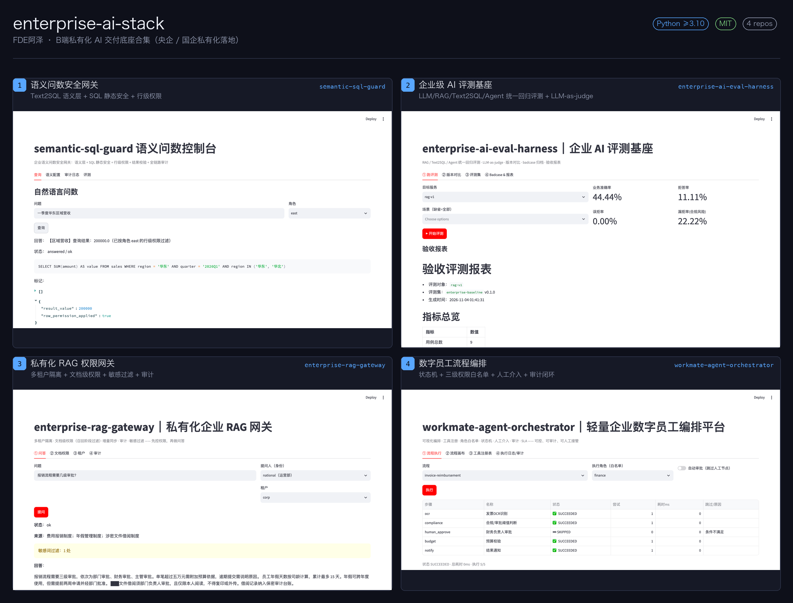
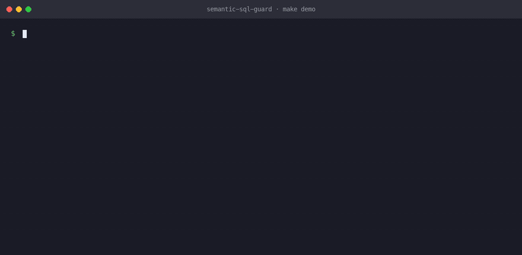
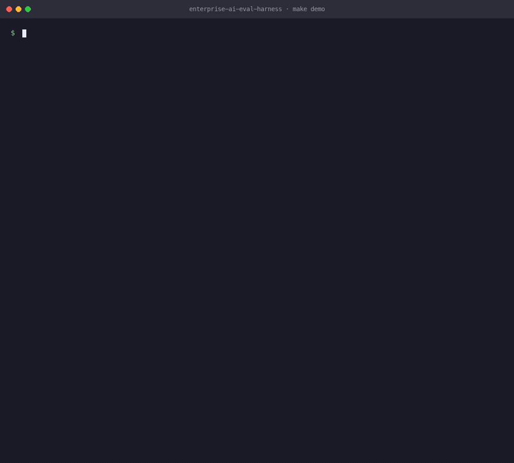
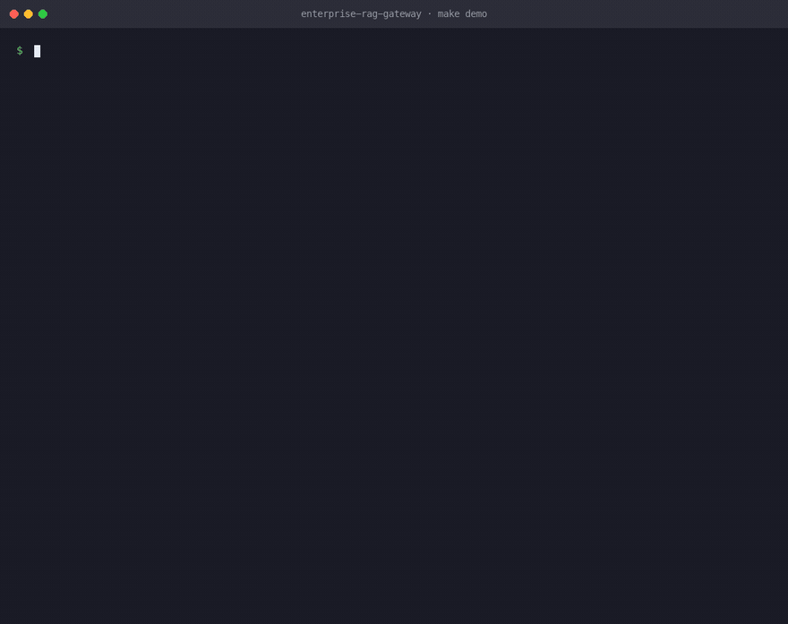
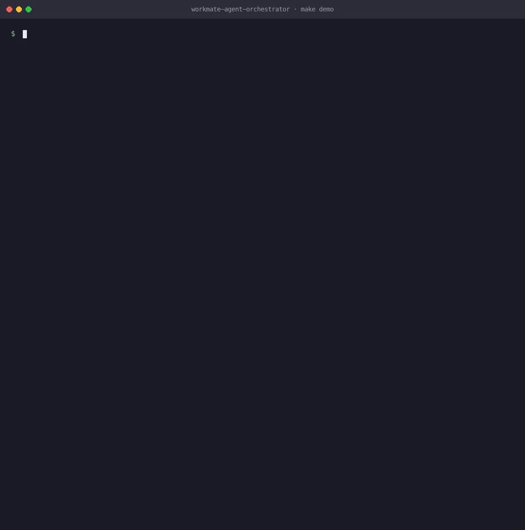

# enterprise-ai-stack

[](https://www.python.org/) [](https://github.com/fenrir1111/enterprise-ai-stack) []() []()

> FDE阿泽 · B端私有化 AI 交付底座合集（央企 / 国企私有化落地）

## 🚀 运行效果（真实截图）

下面 4 张图**全部是各仓库真实跑出来的**，不是 PPT 示意图：Streamlit 控制台实拍 + `make demo` 终端输出，均由本机实跑截图。



## 🎬 一条命令跑通（真实终端录制）

4 个仓库各自的 `make demo` **真实终端录制**（不是模拟动画，输出逐行来自实际运行）：

**semantic-sql-guard** — 语义命中 → 行级权限内联 → 敏感表拦截 → 审计留痕



**enterprise-ai-eval-harness** — 跑评测 → 出指标 → 版本对比 → 归档 badcase → 验收报表



**enterprise-rag-gateway** — 语料同步 → 检索 → 敏感词遮罩 → 召回阶段权限过滤 → 审计



**workmate-agent-orchestrator** — 人工审批介入 → 条件门跳过 → 越权中止 → 步骤级权限 → 重试/超时



## 一句话简介

给**做 B 端 / 央企私有化 AI 交付**的工程师一套能直接用的底座：**问数有权限网关、效果有评测基座、知识有 RAG 权限控制、流程有编排与人工接管**。
4 个仓库互相独立、可单独 clone 即跑，也可拼成一条完整交付链路。

## 为什么做这个（真实交付痛点）

做央企/国企 AI 项目时，反复踩到的不是「模型不够强」，而是这四件事：

| 痛点 | 对应仓库 | 解决思路 |
|---|---|---|
| 业务方问「一季度华东营收」，**每个人口径都不一样** | semantic-sql-guard | 指标注册表 + 术语词典，统一口径，不让模型自由发挥 |
| 模型能写 SQL，但**它不知道谁能看哪张表** | semantic-sql-guard | 行级权限内联进 WHERE，敏感表白名单按角色拦截 |
| 上了 RAG，**越权内容被检索出来** | enterprise-rag-gateway | 权限在**召回阶段**过滤，越权片段不进上下文 |
| 上线后**没人说得清效果是好是坏** | enterprise-ai-eval-harness | 统一回归评测 + LLM-as-judge + badcase 归档 + 验收报表 |
| 流程自动化后**高风险节点没人敢签字** | workmate-agent-orchestrator | 状态机 + 三级权限白名单 + HITL 人工审批 + 审计闭环 |

## 四个仓库

| 仓库 | 定位 | 核心能力 | 测试 |
|---|---|---|---|
| [semantic-sql-guard](https://github.com/fenrir1111/semantic-sql-guard) | 语义问数安全网关 | 语义层 · SQL 静态安全 · 行级权限 · 结果异常校验 | 40 |
| [enterprise-ai-eval-harness](https://github.com/fenrir1111/enterprise-ai-eval-harness) | 企业级 AI 评测基座 | 统一评测 · LLM-as-judge · 版本对比 · badcase · 验收报表 | 38 |
| [enterprise-rag-gateway](https://github.com/fenrir1111/enterprise-rag-gateway) | 私有化 RAG 权限网关 | 多租户隔离 · 文档级权限 · 增量同步 · 敏感过滤 · 审计 | 38 |
| [workmate-agent-orchestrator](https://github.com/fenrir1111/workmate-agent-orchestrator) | 数字员工流程编排 | 状态机 · 三级权限白名单 · HITL · 重试/超时 · 方案包导出 | 37 |

合计 **153 个测试全绿**，4 库均为 MIT 协议，均带 GitHub Actions CI（单测 + demo + 双服务冒烟）。

## 技术栈与工程约定

- **Python ≥3.10** · [hatchling](https://hatch.pypa.io/) 构建 · `src/` 布局 · 统一 `pyproject.toml` / `requirements.txt` / `Makefile` / `Dockerfile` / `docker-compose.yml` / `.env.example`
- **每个仓库都能 clone 即跑**：`make install` → `make demo`（无需起服务）→ `make test` → `make run`（FastAPI）→ `make ui`（Streamlit 控制台）
- **可选依赖默认关闭**：LLM、PostgreSQL/MySQL、Streamlit 均为 extra，不装也能跑通确定性路径
- **默认零外部依赖**：SQLite + 本地 JSON/YAML 语料，POC 开箱即用，生产切 PostgreSQL / 数仓只需改 `DATABASE_URL`
- **每次调用都留痕**：审计日志统一落 `data/audit.log`，可追溯到「问句 → 语义 → SQL → 结果 → 角色 → 时间」

## 典型交付链路

```
用户提问
   ↓
semantic-sql-guard     统一口径 + 生成安全 SQL + 行级权限内联
   ↓
enterprise-rag-gateway 文档级权限在召回阶段过滤 + 敏感词遮罩
   ↓
workmate-agent-orchestrator 编排调用工具，高风险节点转人工审批
   ↓
enterprise-ai-eval-harness 全链路回归评测，输出可交付验收报表
```

## 适用场景

- 央企 / 国企**私有化**知识库与问数项目（数据不出域，满足等保与审计要求）
- 需要**可验收**的 AI 项目交付（客观指标 + judge 打分 + badcase 归档）
- 数字员工 / 单据自动核查 / 报表自动生成类 POC 验证

## 关于我

**FDE阿泽** —— B端 AI 交付 FDE｜央企私有化 AI 落地｜开源项目作者。
关注点在「AI 能力如何在强监管行业真正跑起来」：权限、审计、可验收、可人工接管。

## License

MIT
